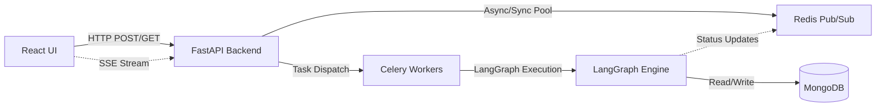

# Cortex AI - Autonomous Research Copilot


Cortex AI is an autonomous, multi-agent research copilot that processes user queries, breaks them down into targeted sub-topics, searches the web, sanitizes data, and iteratively synthesizes a comprehensive report through a critique-driven agent loop.

## Architecture



## Key Engineering Highlights

- **Multi-Agent Critique Loops:** Utilizes LangGraph to implement a dynamic cyclic graph where a Planner, Searcher, Synthesizer, and Critic iteratively refine research reports. A circuit breaker ensures the graph halts upon receiving an "APPROVED" critique or reaching maximum iterations.
- **Prompt Sanitization Boundary:** Implements a dedicated sanitization node to strip HTML tags, system prompt injection attempts, and noise from raw search results before passing data to the synthesizer.
- **Centralized Connection Pooling:** Maintains highly concurrent async and sync Redis connection pools with `max_connections=2000`, supporting robust pub/sub and task queuing under heavy load.
- **Real-Time SSE Streaming:** Delivers low-latency status updates to the React UI via Server-Sent Events (SSE), bridging FastAPI streaming responses with Redis pub/sub channels.

## Quickstart & Setup

### Running via Docker Compose

1. Clone the repository and configure your environment:
   ```bash
   cp backend/.env.example backend/.env
   # Ensure you set GROQ_API_KEY and TAVILY_API_KEY in the .env file.
   ```
2. Build and start the services:
   ```bash
   docker compose up --build -d
   ```
3. Access the React UI at `http://localhost:5173`.
4. The FastAPI Swagger docs are available at `http://localhost:8000/docs`.

### Running Tests

The backend test suite uses `pytest`, `pytest-asyncio`, and `httpx`, with mocked dependencies to run quickly without external services.

```bash
cd backend
pip install -r requirements.txt
pytest tests/ --cov=app --cov-report=term
```

### Concurrency & Load Testing

A robust Locust test suite is provided to validate backend concurrency (e.g., simulating 1000+ concurrent users). To run the load tests without consuming actual LLM API credits:

1. Enable mock mode by setting the environment variable in the terminal where you run Locust, or in your `.env` (if supported by your setup):
   ```bash
   export MOCK_LLM_FOR_LOAD_TEST=true
   ```
2. Start the Locust server:
   ```bash
   cd load_testing
   locust -f locustfile.py
   ```
3. Open `http://localhost:8089` to configure and start the simulated load.

## License

MIT License
